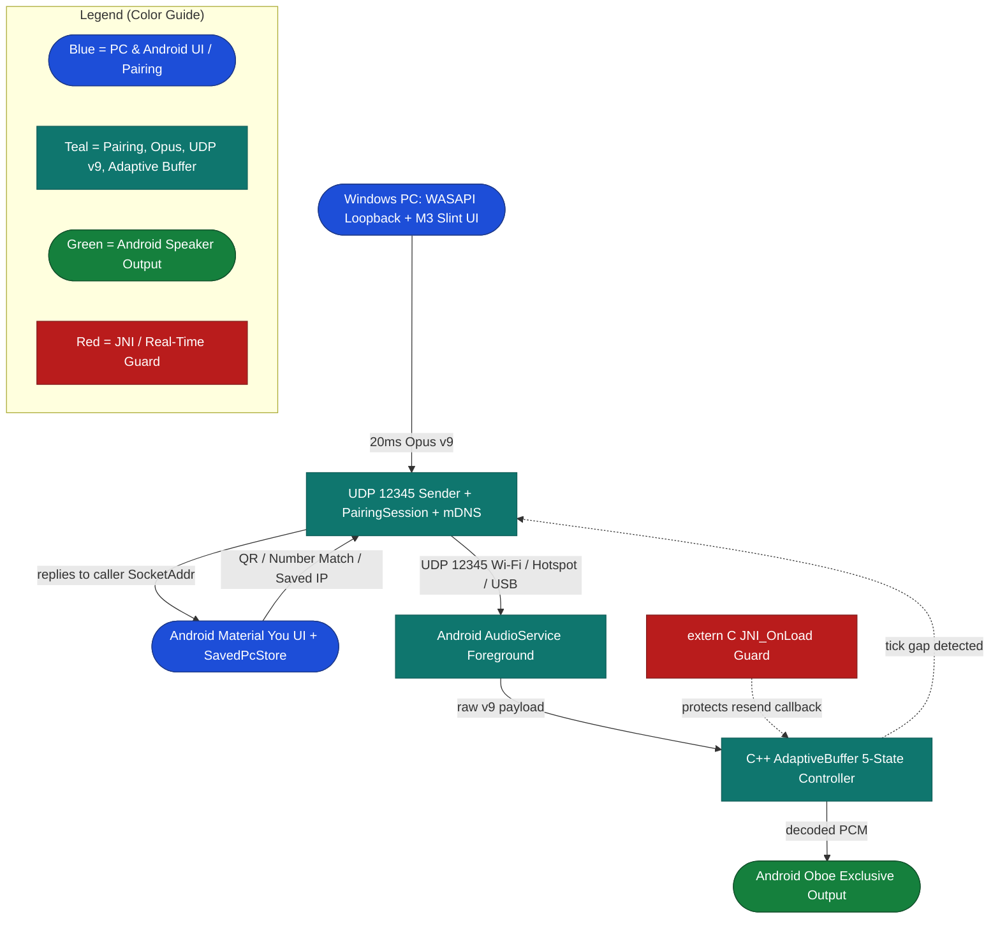

# System Architecture & Visual Flows (`ARCHITECTURE.md`)
> **1-Line Summary:** Living visual map of Mobile Speaker (forked from AS2P), showing Windows WASAPI/Opus capture, UDP v9 + adaptive jitter buffer playback, QR/number-match pairing, and Material You UI layers. *(Build and test commands live in root `AGENTS.md`.)*

## 1. High-Level Visual System Map
* **Plain-English Overview:** The Rust Windows server enumerates local Wi-Fi/hotspot/USB IPv4 addresses into a live QR code and 2-digit match number inside an OS-themed Material 3 Slint window while advertising `_as2p._udp.local.` via mDNS. Once paired via QR scan, number match, or a saved PC profile, Android's Material You interface drives `AudioService` + C++ `AdaptiveBuffer` + Oboe playback.

## 2. Tech Stack & Why We Chose It

| Layer | Tool / Library | Plain-English Reason Why |
| :--- | :--- | :--- |
| Windows Capture & Encode | Rust (`cpal` + `rubato` + `audiopus`) | Captures WASAPI loopback on MMCSS Pro Audio threads and encodes 48 kHz Opus with minimal CPU. |
| PC Pairing & Material UI | `qrcode` + `local-ip-address` + `slint` + `arboard` + `Win32_System_Registry` | Enumerates Wi-Fi/hotspot adapters, renders Material 3 Light/Dark QR window following Windows theme, and copies match codes. |
| Android Material You & Lifecycle | Kotlin + Jetpack Compose (`2024.02.00` BOM) + `zxing-android-embedded` + `NsdManager` | Android 12+ Dynamic Color + Cobalt M3 fallback, offline QR scan, saved-PC switcher, tuning bottom sheet, and foreground service. |
| Android Audio Engine | C++17 + `Oboe` + `libopus` + `AdaptiveBuffer` | Exclusive-mode low-latency output decoupled from network/decode threads via JNI. |

## 3. Core Subsystems & Visual Feature Flows

### [FLOW: Material-You-Theme-And-Saved-PCs] | Aliases: dynamic color, m3 tokens, saved pcs, tuning bottom sheet, sparkline
> **1-Line Summary:** Applies system Light/Dark Material You / Cobalt M3 styling across Windows and Android, persists multiple saved PCs in pure Kotlin TSV storage, and routes custom DSP knobs into a modal bottom sheet.
* **Links:** `[FEATURE: Material-You-And-Saved-PCs]`, `[DECISION: Material-You-Dynamic-And-Cobalt-M3]`, `[TRAP: Slint-Macro-Hex-Exponent-Lexer]`, `[TRAP: JVM-Unit-Tests-Stub-OrgJson]`
* **Plain-English Walkthrough:** On Android, `MobileSpeakerTheme` picks wallpaper `dynamicLightColorScheme`/`dynamicDarkColorScheme` on Android 12+ or Cobalt M3 tokens on API 28–30 following system dark mode; `SavedPcStore` stores up to 5 paired PCs so switching between home Wi-Fi and hotspot is 1 tap; `AudioTuningBottomSheet` keeps advanced sliders tucked away until needed. On Windows, `detect_windows_dark_mode` polls `AppsUseLightTheme` so the Slint window adapts automatically.
* **Code Anchors:**
  * `android/app/src/main/kotlin/com/example/audiobtbridge/ui/theme/Theme.kt :: MobileSpeakerTheme`
  * `android/app/src/main/kotlin/com/example/audiobtbridge/ui/components/SpeakerComponents.kt :: HeroStatusCard`
  * `android/app/src/main/kotlin/com/example/audiobtbridge/SavedPcStore.kt :: SavedPcStore`
  * `android/app/src/main/kotlin/com/example/audiobtbridge/MainActivity.kt :: MainScreen`
  * `server/src/ui.rs :: detect_windows_dark_mode`

### [FLOW: QR-And-Number-Match-Handshake] | Aliases: qr pairing, number match, hotspot discovery, mdns
> **1-Line Summary:** Pairs phone and PC across Wi-Fi, Windows Mobile Hotspot, or Phone Hotspot using either an `as2p://pair` QR scan or a 3-choice 2-digit number match.
* **Links:** `[FEATURE: QR-And-Number-Match-Pairing]`, `[SUBSYSTEM: Audio-Transport-And-Sync]`, `[TRAP: Pairing-Replies-Must-Use-Sender-Port]`
* **Plain-English Walkthrough:**
  1. `PairingSession` on PC gathers active private IPv4s (prioritizing `192.168.137.1` hotspot), builds `as2p://pair?...`, renders an RGBA QR image in Slint, and shows `Match Code: XX`.
  2. Scanning the QR sends `AS2P_QR_PAIR|<token>` directly to all listed IPs in parallel; the reachable IP replies `AS2P_PAIR_ACK` directly to the scanner's ephemeral socket.
  3. Choosing Match Code probes interface broadcasts, active link gateways, `192.168.137.1`, and `_as2p._udp.` mDNS hosts with `AS2P_PAIR_PROBE`, displays the server's 3 shuffled numbers on Android, and verifies the tapped choice via `AS2P_PAIR_VERIFY`.
* **Code Anchors:**
  * `server/src/pairing.rs :: PairingSession`
  * `server/src/pairing.rs :: list_candidate_ipv4s`
  * `server/src/ui.rs :: run_ui`
  * `android/app/src/main/kotlin/com/example/audiobtbridge/PairingProtocol.kt :: PairingProtocol`
  * `android/app/src/main/kotlin/com/example/audiobtbridge/PairingClient.kt :: PairingClient`
  * `android/app/src/main/kotlin/com/example/audiobtbridge/MainActivity.kt :: MainScreen`

### [SUBSYSTEM: Audio-Transport-And-Sync] | Aliases: wasapi loopback, opus, adaptive jitter buffer, v9 packet, oboe
> **1-Line Summary:** End-to-end Windows WASAPI capture, Opus UDP v9 streaming with on-demand retransmission, and Android 5-state adaptive Oboe playback.
* **Links:** `[FEATURE: Adaptive-Opus-Streaming]`, `[FEATURE: Low-Latency-Oboe-Playback]`, `[FEATURE: MMCSS-WASAPI-Capture]`, `[FLOW: QR-And-Number-Match-Handshake]`, `[WISHLIST: Seamless-USB-ADB-And-Tethering]`, `[DECISION: Fork-AS2P-Over-AudioShare]`, `[DECISION: GitHub-First-Public-Repo]`, `[TRAP: JNI-OnLoad-Extern-C]`, `[TRAP: WASAPI-Loopback-Silence-Stall]`, `[TRAP: Android-USB-Needs-ADB-Or-Tethering]`
* **Plain-English Walkthrough:** The Windows server listens on `0.0.0.0:12345`, handles pairing/discovery and `AS2P_CONFIG`, and spawns a decoupled capture/encode worker sending v9 packets (`media_tick`, `send_ts_ms`, `flags`, `seq`). Android feeds packets into `AdaptiveBuffer`, requests resends (`AS2P_RESEND`) on gaps, and plays PCM via Oboe while reporting `AS2P_STATS` every second.
* **Code Anchors:**
  * `server/src/main.rs :: main`
  * `server/src/audio.rs :: MmcssGuard`
  * `server/src/encoder.rs :: encode_frame`
  * `server/src/network.rs :: UdpSender`
  * `server/src/discovery.rs :: DiscoveryServer`
  * `android/app/src/main/kotlin/com/example/audiobtbridge/AudioService.kt :: AudioService`
  * `android/app/src/main/cpp/adaptive_buffer.h :: AdaptiveBuffer`

## 4. Recipes: How to Add New Things Safely
* **To extend pairing payload fields:**
  1. Add optional query parameter in `server/src/pairing.rs :: build_qr_uri`.
  2. Parse safely with fallback default in `android/app/src/main/kotlin/com/example/audiobtbridge/PairingProtocol.kt :: parseQrPayload` and cover in `PairingProtocolTest.kt`.
