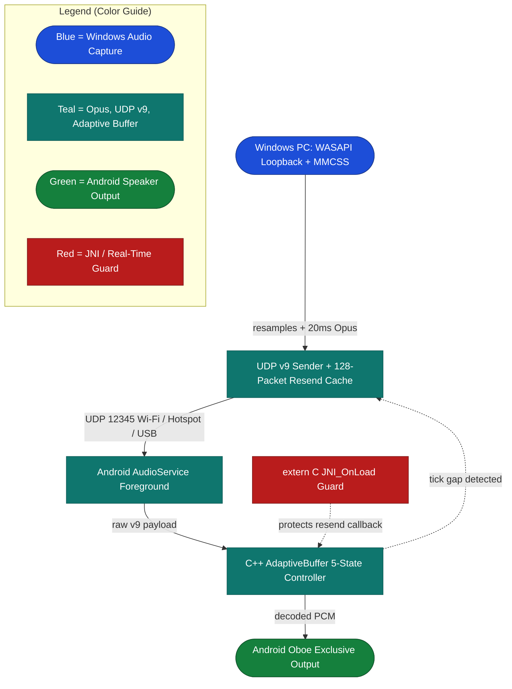

# System Architecture & Visual Flows (`ARCHITECTURE.md`)
> **1-Line Summary:** Living visual map of Mobile Speaker (forked from AS2P), showing Windows WASAPI/Opus capture, UDP v9 + adaptive jitter buffer playback, and planned QR/number-match pairing. *(Build and test commands live in root `AGENTS.md`.)*

## 1. High-Level Visual System Map
* **Plain-English Overview:** The Rust Windows server captures system audio via WASAPI loopback on a Pro Audio MMCSS thread, resamples to 48 kHz, and encodes 20 ms Opus frames into v9 UDP packets. The Android client receives frames on a foreground service, decodes on a `nice -16` thread through a 5-state adaptive jitter buffer, and outputs via C++ Oboe. Planned upgrades add QR + number-match pairing across Wi-Fi/hotspots and `adb reverse` wired fallback.

## 2. Tech Stack & Why We Chose It

| Layer | Tool / Library | Plain-English Reason Why |
| :--- | :--- | :--- |
| Windows Capture & Encode | Rust (`cpal` + `rubato` + `audiopus`) | Captures WASAPI loopback on MMCSS Pro Audio threads and encodes 48 kHz Opus with minimal CPU. |
| Windows UI & Tray | `slint` + `tray-icon` | Lightweight single-binary desktop window and system tray control (< 0.1% idle CPU). |
| Android UI & Lifecycle | Kotlin + Jetpack Compose + Foreground Service | Holds `PARTIAL_WAKE_LOCK`, `MulticastLock`, and MediaStyle notification so streaming survives screen off. |
| Android Audio Engine | C++17 + `Oboe` + `libopus` + `AdaptiveBuffer` | Exclusive-mode low-latency output decoupled from network/decode threads via JNI. |

## 3. Core Subsystems & Visual Feature Flows

### [SUBSYSTEM: Audio-Transport-And-Sync] | Aliases: wasapi loopback, opus, adaptive jitter buffer, v9 packet, oboe
> **1-Line Summary:** End-to-end Windows WASAPI capture, Opus UDP v9 streaming with on-demand retransmission, and Android 5-state adaptive Oboe playback.
* **Links:** `[FEATURE: Adaptive-Opus-Streaming]`, `[FEATURE: Low-Latency-Oboe-Playback]`, `[FEATURE: MMCSS-WASAPI-Capture]`, `[WISHLIST: QR-And-Number-Match-Pairing]`, `[WISHLIST: Seamless-USB-ADB-And-Tethering]`, `[WISHLIST: Polished-PC-And-Android-UI]`, `[DECISION: Fork-AS2P-Over-AudioShare]`, `[DECISION: GitHub-First-Public-Repo]`, `[TRAP: JNI-OnLoad-Extern-C]`, `[TRAP: WASAPI-Loopback-Silence-Stall]`, `[TRAP: Android-USB-Needs-ADB-Or-Tethering]`
* **Plain-English Walkthrough:** The Windows server listens on `0.0.0.0:12345`, performs `AS2P_DISCOVER`/`AS2P_OFFER` handshake + `AS2P_CONFIG`, and spawns a decoupled capture/encode worker sending v9 packets (`media_tick`, `send_ts_ms`, `flags`, `seq`). Android feeds packets into `AdaptiveBuffer`, requests resends (`AS2P_RESEND`) on gaps, and plays PCM via Oboe while reporting `AS2P_STATS` every second.
* **Code Anchors:**
  * `server/src/main.rs :: main`
  * `server/src/audio.rs :: MmcssGuard`
  * `server/src/encoder.rs :: encode_frame`
  * `server/src/network.rs :: UdpSender`
  * `android/app/src/main/kotlin/com/example/audiobtbridge/AudioService.kt :: AudioService`
  * `android/app/src/main/cpp/adaptive_buffer.h :: AdaptiveBuffer`

## 4. Recipes: How to Add New Things Safely
* **To extend pairing (QR + Number Match):**
  1. Enumerate local IPv4 addresses + generate pairing session token/code in `server/src/` (keeping `UDP 12345` compatibility).
  2. Display QR + 2-digit code in `server/src/ui.slint :: AppWindow` and handle scan/tap verification in `android/app/src/main/kotlin/com/example/audiobtbridge/MainActivity.kt :: MainActivity`.
