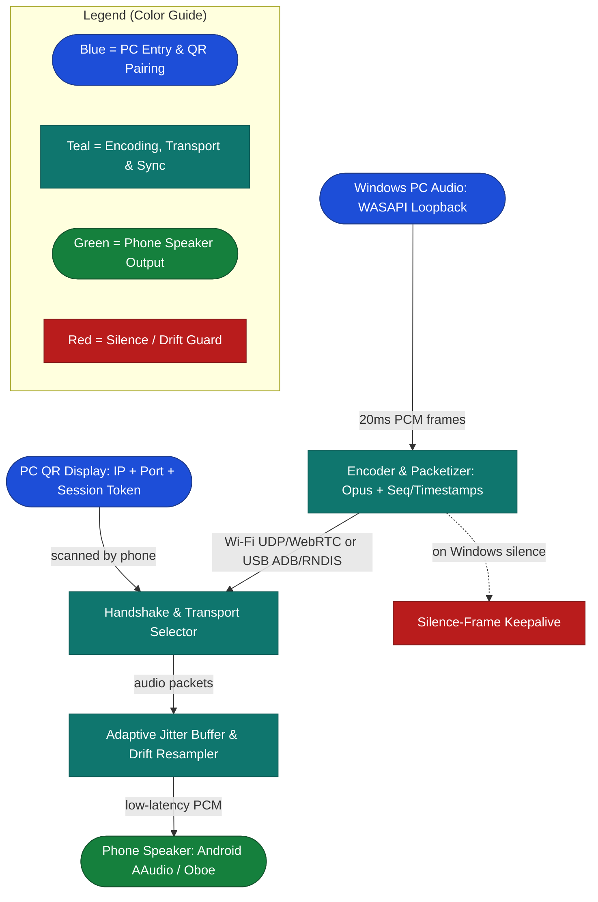

# System Architecture & Visual Flows (`ARCHITECTURE.md`)
> **1-Line Summary:** Living visual map of the planned Mobile Speaker pipeline from Windows system audio capture through QR-paired Wi-Fi/USB transport to synchronized Android playback. *(Build and test commands live in root `AGENTS.md`.)*

## 1. High-Level Visual System Map
* **Plain-English Overview:** The Windows PC captures live speaker output via WASAPI loopback, encodes 20 ms frames with Opus (or lossless PCM over USB), and advertises a QR pairing payload over LAN/ADB. The phone app scans the QR code, connects via UDP/WebRTC over Wi-Fi or an ADB/RNDIS tunnel over USB, and feeds an adaptive jitter buffer + drift resampler into Android's low-latency audio output (AAudio/Oboe or AudioTrack).

## 2. Tech Stack & Why We Chose It
*(Pending Path B user confirmation — candidate options below reflect feasibility analysis.)*

| Layer | Candidate / Chosen Tool | Plain-English Reason Why |
| :--- | :--- | :--- |
| PC Sender & Signaling | *(Pending Path B: Go / Python / TypeScript / Fork)* | Captures Windows WASAPI loopback, displays QR code, manages ADB/LAN transport. |
| Audio Codec | Opus (20 ms frames, 48 kHz stereo) | Low algorithmic delay with high fidelity and resilience to Wi-Fi packet loss. |
| Phone Receiver | *(Pending Path B: Native Android Kotlin+Oboe vs. WebRTC PWA vs. Fork)* | Needs low-latency AAudio/Oboe playback, camera QR scan, and background service stability. |

## 3. Core Subsystems & Visual Feature Flows

### [SUBSYSTEM: Audio-Transport-And-Sync] | Aliases: wasapi loopback, opus, adaptive jitter buffer, qr pairing, adb forward
> **1-Line Summary:** End-to-end audio capture, QR-bootstrapped Wi-Fi/USB transport, and clock-drift-compensated playback pipeline.
* **Links:** `[WISHLIST: QR-Instant-Pairing]`, `[WISHLIST: Dual-Transport-WiFi-And-USB]`, `[WISHLIST: Adaptive-Sync-And-Quality]`, `[DECISION: Local-Only-Repo-Bootstrap]`, `[TRAP: WASAPI-Loopback-Silence-Stall]`, `[TRAP: Android-USB-Needs-ADB-Or-Tethering]`
* **Plain-English Walkthrough:** The PC sender opens a WASAPI loopback stream on the active playback device and exposes a lightweight pairing endpoint encoded in a QR matrix. Scanning the QR code exchanges capabilities and RTT/clock offsets, then starts streaming timestamped audio frames over Wi-Fi or wired USB while dynamically adjusting buffer target depth to prevent underruns and cumulative latency drift.
* **Code Anchors:**
  * *(Pending implementation after Path B confirmation; doc-parity check anchored in `local-ci.ps1 :: Test-RepoStructureAndDocParity`)*

## 4. Recipes: How to Add New Things Safely
*(To be populated once the chosen codebase structure is scaffolded.)*
